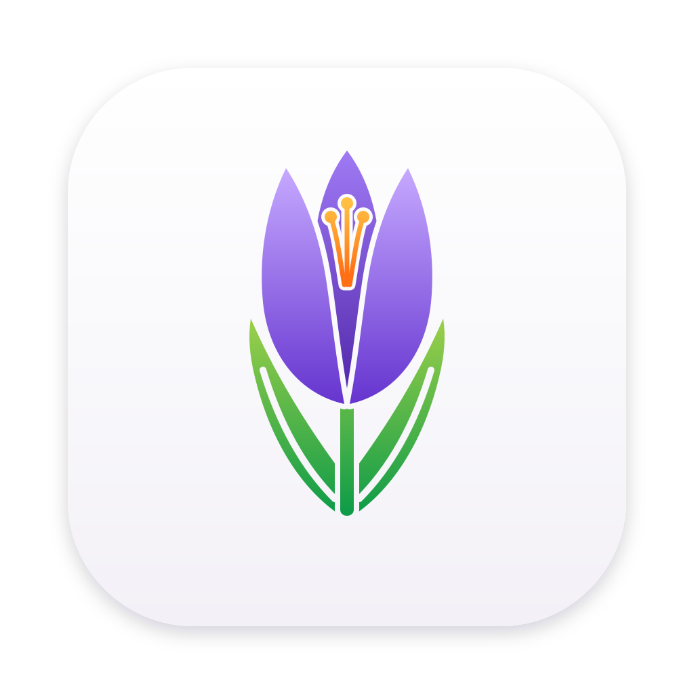
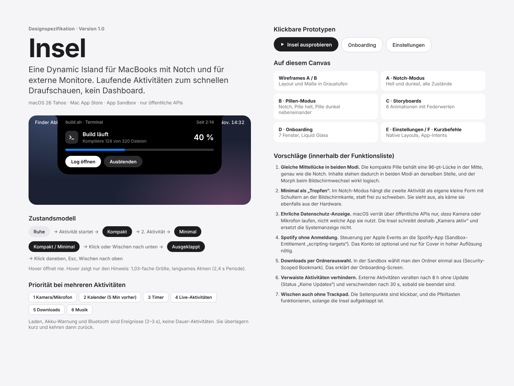

# Crocus

Crocus brings a Dynamic-Island-style live activity area to the Mac: a black island that grows out of the notch (or floats as a pill on external displays) and shows timers, now playing, charging, calendar, downloads and more – with springy animations and full keyboard and VoiceOver support.



The visual design lives in [`design/`](design/README.md). Apps, scripts and shortcuts can push their own activities via the `crocus://` URL scheme or the Shortcuts actions – see [Live Activities](docs/live-activities.md). Crocus also has a built-in [timer and stopwatch](docs/timer.md) shows [what Spotify or Music is playing](docs/now-playing.md) [charging and low battery](docs/power.md), your [next calendar event](docs/calendar.md), when [camera or microphone are in use](docs/privacy-indicator.md), [running downloads](docs/downloads.md) and [Bluetooth devices connecting](docs/bluetooth.md).

## Requirements

- macOS 26 Tahoe
- Xcode 27 or later
- [XcodeGen](https://github.com/yonaskolb/XcodeGen): `brew install xcodegen`

## Build

`project.yml` is the source of truth for the Xcode project. After changing it (or adding/removing files), regenerate the project:

```sh
xcodegen generate
```

Then open `Crocus.xcodeproj` in Xcode and run the `Crocus` scheme, or build and test from the command line:

```sh
xcodebuild -project Crocus.xcodeproj -scheme Crocus -destination 'platform=macOS' build
xcodebuild -project Crocus.xcodeproj -scheme Crocus -destination 'platform=macOS' test
```

Crocus runs as a menu bar agent (no Dock icon) inside the App Sandbox. Look for the crocus icon in the menu bar to open Settings or quit. Try a Live Activity: `open -g "crocus://start?id=demo&title=Demo&symbol=hammer&progress=0.5"`.

Builds are signed with an Apple Development certificate of the team in `project.yml` (`DEVELOPMENT_TEAM`). To build with your own account, change it to your team ID. The Shortcuts actions need a team-signed build – with an ad-hoc signature ("Sign to Run Locally"), Shortcuts fails with "couldn't communicate with the app".

## Project layout

| Folder | Contents |
|---|---|
| `Crocus/App` | App entry point, app delegate, URL routing |
| `Crocus/Island` | Island shape, states and views |
| `Crocus/Activities` | One folder per activity source |
| `Crocus/Platform` | Screens, windows, permissions |
| `Crocus/DesignSystem` | Colors, typography, springs and sizes from the spec |
| `Crocus/Intents` | App Intents for Shortcuts |
| `CrocusTests` | Unit tests |

## License

© 2026 Bilal Batmaz. All rights reserved. The source is available for viewing and personal testing only – copying, modifying, redistributing or selling it requires written permission. See [LICENSE](LICENSE).
