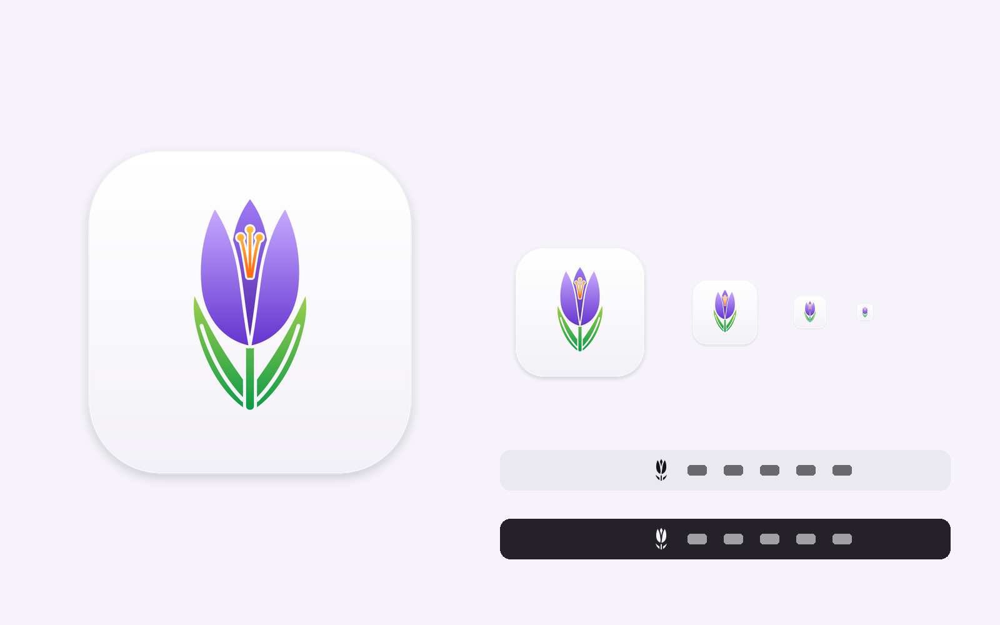

# Crocus icon

| File | Use |
|---|---|
| `AppIcon.appiconset/` | Drop-in replacement for `Crocus/Resources/Assets.xcassets/AppIcon.appiconset` (all Mac sizes, 16–1024 px) |
| `MenuBarIcon.imageset/` | Menu bar icon, template image (@1x 18 px, @2x 36 px) – copy to `Assets.xcassets/` |
| `app-icon.svg`, `app-icon-1024.png` | App icon source and master render |
| `menubar-icon.svg` | Menu bar silhouette source (black on transparent) |
| `icon-board.png` | Overview: app icon at several sizes, menu bar in light and dark |

Re-render sizes from the SVG with `rsvg-convert -w <px> app-icon.svg -o out.png`.
